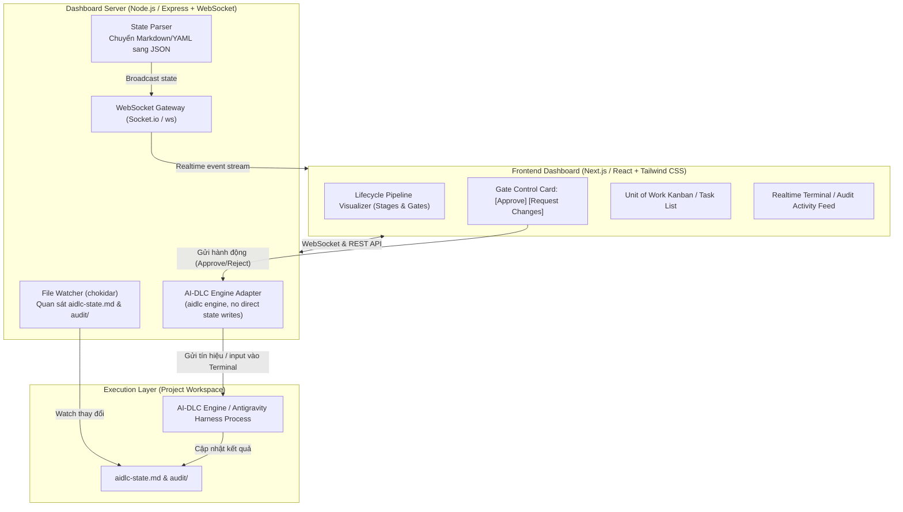
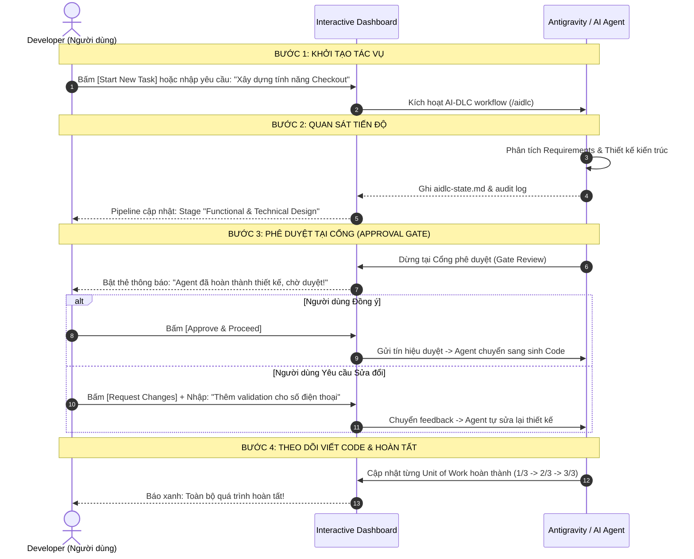

# Kế Hoạch & Thiết Kế Kiến Trúc: AI-DLC Interactive Dashboard

Tài liệu này tổng hợp toàn bộ nghiên cứu, kiến trúc kỹ thuật và lộ trình triển khai xây dựng **Interactive Dashboard** dùng để theo dõi và điều khiển các AI Coding Agents hoạt động theo framework **[`awslabs/aidlc-workflows`](https://github.com/awslabs/aidlc-workflows)** (hỗ trợ Google Antigravity và các AI Coding Harness khác).

---

## 1. Tổng Quan về `aidlc-workflows`

### 1.1 Khái niệm AI-DLC
**AI-DLC (AI-Driven Development Life Cycle)** là phương pháp luận và framework mã nguồn mở do **AWS Labs** phát triển nhằm biến việc sinh code tự do của AI thành một quy trình phát triển phần mềm chuẩn mực, có kiểm soát và có khả năng truy vết:
* **Gated Lifecycle:** Chia tiến trình thành các pha cụ thể (*Inception*, *Construction*, *Operations*) với 33 giai đoạn (stages) chuẩn mực.
* **Human-in-the-Loop:** Bắt buộc có các trạm dừng phê duyệt (**Approval Gates**) trước khi chuyển giai đoạn hoặc commit code quan trọng.
* **Deterministic Single Source of Truth:** Tiến độ và lịch sử được ghi nhận minh bạch dưới dạng file Markdown/YAML trên ổ đĩa (`aidlc-state.md` và `audit/`).

### 1.2 Hỗ trợ Antigravity
Framework `aidlc-workflows` được thiết kế theo kiến trúc **harness-neutral** (tách biệt Core Engine và Harness Adapter):
* Hỗ trợ đa dạng harness: Claude Code, Cursor, GitHub Copilot, Codex CLI, Kiro, và **Google Antigravity**.
* Khi tích hợp với Antigravity, `aidlc` cấu hình các steering rules, slash commands (`/aidlc`), và hook điều phối các subagents tuân thủ workflow.
* Dashboard có thể chạy độc lập dưới dạng Web App hoặc tích hợp thành **UI Plugin Panel** trong Antigravity IDE.

---

## 2. Cấu Trúc Dữ Liệu State Machine của AI-DLC

Khi chạy trong một project, `aidlc` tạo thư mục quản lý intent:
```text
your-project/
├── aidlc/
│   └── spaces/
│       └── <space-name>/
│           └── intents/
│               └── <intent-id>/              # Ví dụ: 261105-user-auth
│                   ├── aidlc-state.md        # Single Source of Truth (trạng thái hiện tại)
│                   ├── audit/                # Nhật ký kiểm toán dạng append-only
│                   │   └── <host>-<clone>.md # Log các sự kiện, quyết định, mốc thời gian
│                   └── artifacts/            # Requirements, specs, architecture, test plan...
```

### 2.1 File `aidlc-state.md`
Lưu trữ:
* **Phase & Stage hiện tại:** Đang ở đâu trong vòng đời (vd: Inception / Functional Design).
* **Trạng thái Gate:** Đang chạy hay đang dừng chờ phê duyệt (*Pending Approval*).
* **Active Agents:** Agent nào đang thực hiện task.
* **Danh sách Units of Work:** Các tác vụ chi tiết kèm trạng thái (*Pending / In Progress / Completed*).

### 2.2 Thư mục `audit/`
Ghi log tuần tự từng sự kiện:
* Thời gian kích hoạt stage.
* Các quyết định kiến trúc của agent.
* Nội dung phản hồi từ con người qua các cổng phê duyệt.

---

## 3. Kiến Trúc Kỹ Thuật Interactive Dashboard

Trong project thật, AI-DLC engine là nguồn quyền lực duy nhất đối với
lifecycle. Dashboard chỉ đọc state/audit và gửi command qua `aidlc engine`; nó
không tự ghi đè `aidlc-state.md`. Cơ chế sửa file trực tiếp chỉ dành cho
`--demo`.

Hệ thống hoạt động theo mô hình **hai chiều (Two-Way Control Plane)**: vừa cập nhật tiến độ theo thời gian thực (Read/Observe), vừa cho phép người dùng ra lệnh điều khiển (Control/Write).



---

## 4. Các Tính Năng Cốt Lõi Của Dashboard

### 4.1 Bảng Điều Khiển Trực Quan (Observability)
1. **Pipeline & Stage Progress Bar:**
   * Hiển thị dòng thời gian từ *Inception* $\rightarrow$ *Construction* $\rightarrow$ *Operations*.
   * Màu sắc phân biệt: Xanh lá (Hoàn thành), Vàng nhấp nháy (Đang xử lý / Chờ phê duyệt), Xám (Chưa chạy).
2. **Unit of Work Board:**
   * Danh sách các task cụ thể theo dạng thẻ hoặc Kanban (To Do, In Progress, Review, Done).
3. **Live Activity & Audit Feed:**
   * Hiển thị log stream từ thư mục `audit/` theo thời gian thực, có filter theo mức độ (info, decision, warning).

### 4.2 Bộ Điều Khiển Tương Tác Hai Chiều (Interactive Control)
1. **Approval Gate Action Card:**
   * Khi Agent đến cổng chờ duyệt, Dashboard bật thông báo:
     * Nút **`Approve & Proceed`**: Xác nhận đồng ý để Agent chuyển sang bước kế tiếp.
     * Nút **`Request Changes`**: Mở hộp thoại nhập góp ý (feedback) để gửi lại cho Agent sửa lại.
2. **Stage Navigator (Điều Hướng Vòng Đời):**
   * Cho phép chọn quay lại stage trước hoặc nhảy cóc sang stage mong muốn (tương đương lệnh `/aidlc --stage <name>`).
3. **Session Control:**
   * Nút **Pause / Resume**: Tạm dừng hoặc tiếp tục phiên làm việc của Agent.
   * Nút **Cancel / Abort**: Hủy bỏ tiến trình khẩn cấp nếu Agent gặp vòng lặp vô tận.

---

## 5. Cơ Chế Điều Khiển Kỹ Thuật (Control Mechanism)

Trong project thật, Dashboard gửi lifecycle action tới AI-DLC engine. PTY chỉ
là phần mở rộng để quản lý session agent, không phải cách dashboard tự xác
nhận gate.

### Giải pháp mở rộng: Quản lý qua Pseudo-Terminal (PTY)
* Backend Dashboard khởi tạo tiến trình Agent bằng thư viện `node-pty`.
* Toàn bộ stdout/stderr được truyền qua WebSocket về terminal trên web.
* Khi người dùng bấm nút **Approve** hay nhập **Feedback**, Backend ghi input thẳng vào stdin của tiến trình PTY (`ptyProcess.write("Approve\n")`).
* **Ưu điểm:** Tương thích 100% với mọi CLI (Claude, Antigravity CLI, Cursor CLI) mà không cần can thiệp source code của `aidlc-workflows`.

### Giải pháp demo: File-based Signal & Directives
* Dashboard ghi trực tiếp file chỉ thị điều khiển hoặc cập nhật cờ trong thư mục intent.
* Hook của `aidlc` đọc tín hiệu từ file này để ra quyết định chuyển bước.
* **Ưu điểm:** Nhẹ nhàng, không phụ thuộc vào trạng thái terminal active.

---

## 6. Lộ Trình Triển Khai (Implementation Roadmap)

### Giai đoạn 1: Khởi tạo dự án & Bộ đọc dữ liệu (Parser & Watcher)
* Khởi tạo template project (Next.js App Router hoặc Express + React/Vite).
* Cài đặt thư viện theo dõi file (`chokidar`) và thư viện parse Markdown (`gray-matter`, `unified`, `remark`).
* Viết parser đọc cấu trúc `aidlc-state.md` và parse các shard log trong thư mục `audit/`.

### Giai đoạn 2: Thiết lập WebSocket & Giao diện Dashboard (Read-only)
* Dựng WebSocket Server phát sự kiện khi file state/audit có thay đổi.
* Thiết kế UI với Tailwind CSS / shadcn-ui:
  * Component hiển thị các giai đoạn (Stage Graph / Stepper).
  * Component danh sách Unit of Work.
  * Component stream log hoạt động của Agent.

### Giai đoạn 3: Tích hợp Bộ Điều Khiển Hai Chiều (Interactive Control)
* Triển khai `node-pty` hoặc Control API ở Backend để tương tác với tiến trình chạy `aidlc`.
* Xây dựng Modal & Action Buttons trên UI để:
  * Duyệt Gate (`Approve`).
  * Gửi nhận xét chỉnh sửa (`Request Changes`).
  * Chuyển stage chủ động (`Jump Stage`).

### Giai đoạn 4: Mở rộng Antigravity UI Plugin
* Đóng gói Dashboard để có thể nhúng trực tiếp vào side-panel của Antigravity IDE thông qua chuẩn UI Plugin của Antigravity.

---

## 7. Phương Thức Khởi Động & Kịch Bản Sử Dụng Thực Tế (UX & Launch Modes)

### 7.1 Các Phương Thức Khởi Động (Launch Modes)

Người dùng có thể khởi động Dashboard theo 3 cách tùy theo ngữ cảnh làm việc:

1. **Lệnh CLI trong Project (Khuyên dùng - Tiện lợi tương tự `prisma studio` hay `storybook`):**
   ```bash
   cd /path/to/my-project
   npx aidlc-dashboard
   # hoặc: aidlc-dashboard start
   ```
   * Tự động khởi chạy local server tại `http://localhost:3300` và tự động mở tab trên trình duyệt.
   * Tự động nhận diện thư mục `aidlc/` trong project hiện tại để lắng nghe và điều khiển.

2. **Antigravity UI Plugin (Nhúng trong Antigravity IDE):**
   * Người dùng mở Side Panel của Antigravity IDE hoặc gõ `/aidlc-dashboard`.
   * Giao diện Dashboard mở trực tiếp trong một tab bên cạnh khung chat và code editor, không cần rời khỏi IDE.

3. **Multi-Project Central Hub (Trạm Quản Lý Tập Trung):**
   * Dashboard chạy như một service thường trực, có giao diện chọn Workspace/Project để theo dõi và điều khiển đồng thời nhiều dự án đang chạy AI-DLC.

---

### 7.2 Quy Trình Trải Nghiệm Thực Tế (User Journey)



---

### 7.3 So Sánh Trải Nghiệm (Trước và Sau khi có Dashboard)

| Nghiệp vụ | Trước đây (Chỉ dùng Chat / Terminal) | Khi có Interactive Dashboard |
| :--- | :--- | :--- |
| **Theo dõi tiến độ** | Phải cuộn terminal dài dằng dặc, khó biết agent đang ở bước nào trong 33 stages. | **Nhìn vào Pipeline Stepper trực quan**, thấy rõ ràng giai đoạn hiện tại, % hoàn thành và các task còn lại. |
| **Duyệt bài (Gate Approval)** | Phải ngồi canh màn hình terminal và gõ phản hồi bằng tay. | **Nhận thông báo nổi bật**, xem bản tóm tắt thay đổi và bấm **1 click `[Approve]`**. |
| **Yêu cầu chỉnh sửa** | Gõ prompt dài vào chat, dễ bị agent hiểu nhầm ngữ cảnh. | **Bấm `[Request Changes]`**, form có sẵn ngữ cảnh của stage hiện tại, nhập phản hồi ngắn gọn. |
| **Xem lịch sử quyết định** | Phải tự mở và đọc các file markdown trong `aidlc/spaces/...`. | **Tab Audit Feed** trên Dashboard hiển thị timeline đẹp mắt, có bộ lọc theo thời gian. |

